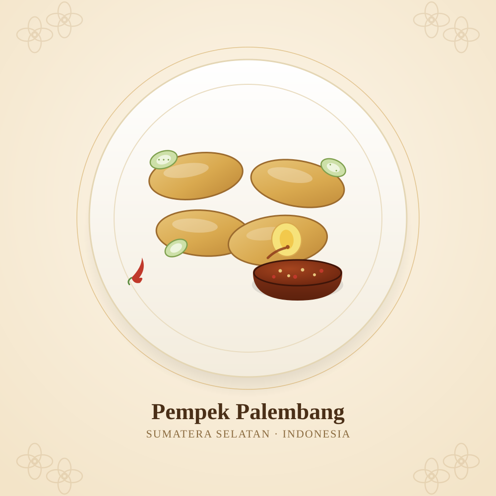

# Galeri Kuliner & Budaya Indonesia · Indonesian Culinary & Culture Gallery

*[Bahasa Indonesia](#bahasa-indonesia) · [English](#english)*

> Proyek ini pada intinya adalah alat teknis untuk mengelola PgBouncer. Namun kami juga ingin
> memanfaatkan ruang ini — sekecil apa pun — untuk ikut mempromosikan kekayaan kuliner, budaya,
> dan seni Indonesia kepada komunitas open source global. Halaman ini adalah perintisannya,
> dimulai dari **Pempek, Palembang**, dan diharapkan akan terus bertambah dari waktu ke waktu.
>
> This project is, at its core, a technical tool for managing PgBouncer. But we also want to use
> this space — however small — to help promote the richness of Indonesia's culinary heritage,
> culture, and art to the global open source community. This page is where that starts, with
> **Pempek, from Palembang**, and is meant to keep growing over time.

  

---

## Bahasa Indonesia

### Pempek, Palembang

Pempek bukan sekadar olahan ikan dan tepung, melainkan mahakarya akulturasi budaya yang lahir dari Sungai Musi. Hidangan ini memadukan kekayaan alam lokal Palembang dengan teknik pengolahan kuliner Tionghoa.

---

**Sejarah & Asal Usul: Dari Kelesan ke Pempek**

Sebelum populer dengan nama "pempek", kudapan ini awalnya bernama **kelesan**. Nama kelesan diambil dari kata *dikeles*, yaitu proses menekan atau memipihkan adonan agar tahan lama saat disimpan. Pada masa Kesultanan Palembang (sekitar abad ke-16 hingga ke-17), kelesan merupakan makanan rumahan bangsawan yang disajikan di Rumah Limas untuk acara adat.

Perubahan nama menjadi "pempek" berawal pada era penjajahan Belanda sekitar tahun 1916. Kala itu, pedagang keturunan Tionghoa mulai menjajakan kelesan keliling kota menggunakan sepeda atau memikulnya. Para pelanggan menyapa penjual pria tua Tionghoa tersebut dengan sebutan *"Apek"* atau *"Empek"* (artinya paman atau kakek). Panggilan *"Pek... empek, mampir sini!"* lama-kelamaan melekat hingga masyarakat lebih terbiasa menyebut penganan ini sebagai **pempek**.

---

**Jejak Akulturasi Peranakan Tionghoa**

Hubungan perdagangan di sepanjang Sungai Musi membawa warga Tionghoa bermukim di Palembang. Akulturasi ini memicu lahirnya pempek melalui beberapa aspek penting:

* **Teknik Pengolahan Ikan:** Masyarakat Tionghoa memiliki tradisi mengolah daging ikan cincang halus menjadi adonan kenyal (mirip bakso ikan/kekian). Mereka mencampur hasil tangkapan ikan Sungai Musi yang berlimpah dengan tepung tapioka/sagu lokal agar awet dan memiliki tekstur khas.
* **Penggunaan Ebi pada Cuko:** Kuah cuko otentik Palembang mendapatkan sentuhan gurih (umami) dari penambahan ebi (udang kering yang dihaluskan), teknik penyedap yang erat dengan tradisi masak Peranakan.
* **Komersialisasi Kuliner:** Kemampuan berdagang warga Tionghoa Peranakan mentransformasi kelesan yang tadinya hidangan internal keluarga menjadi komoditas kuliner publik yang populer ke seluruh pelosok.

---

**Ragam Varian Utama Pempek**

| Varian | Ciri Khas & Keunikan |
| --- | --- |
| **Kapal Selam** | Berukuran besar, berisi telur utuh. Dinamakan kapal selam karena adonan akan tenggelam saat direbus dan mengapung naik saat matang. |
| **Lenjer** | Pempek berbentuk silinder panjang, merupakan bentuk dasar paling tradisional dari adonan kelesan. |
| **Adaan** | Pempek bulat berbentuk mirip bakso ikan dengan tambahan irisan daun bawang dan bawang merah halus. |
| **Kulit** | Memanfaatkan kulit ikan segar sehingga warnanya lebih gelap, bertekstur garing di luar dan gurih renyah. |
| **Pistel** | Berbentuk seperti pastel kecil dengan isian tumisan pepaya muda dan ebi. |

---

**Cuko: Jiwa dari Pempek**

Bagi warga Palembang, menyantap pempek tidak sempurna tanpa **cuko**. Cuko terbuat dari rebusan gula aren batok (gula merah gelap khas Sumatera Selatan), asam jawa, bawang putih, dan cabai rawit.

Ada tradisi lokal bernama **"ngocek cuko"**, yaitu cara menikmati cuko dengan menyeruputnya langsung dari mangkuk kecil atau cangkir setelah memakan potongan pempek. Perpaduan rasa asam, manis, pedas, dan gurih gurih ebi menghasilkan sensasi kuliner yang kaya dan khas.

[↑ Kembali ke atas](#galeri-kuliner--budaya-indonesia--indonesian-culinary--culture-gallery)

---

## English

### Pempek, Palembang

Pempek is not merely a dish of fish and flour — it is a masterpiece of cultural acculturation born on the banks of the Musi River. This dish blends Palembang's rich local ingredients with Chinese culinary processing techniques.

---

**History & Origins: From Kelesan to Pempek**

Before it became known as "pempek," this snack was originally called **kelesan**. The name comes from the word *dikeles*, referring to the process of pressing or flattening the dough so it would keep longer. During the era of the Palembang Sultanate (roughly the 16th to 17th century), kelesan was a home-cooked dish of the nobility, served at the traditional stilt house known as Rumah Limas for customary ceremonies.

The name changed to "pempek" during the Dutch colonial era, around 1916. At that time, traders of Chinese descent began selling kelesan around the city, carrying it on bicycles or shoulder poles. Customers would greet these elderly Chinese vendors as *"Apek"* or *"Empek"* (meaning uncle or grandfather). The call of *"Pek... empek, come over here!"* gradually stuck, until people grew accustomed to calling the snack **pempek**.

---

**Traces of Peranakan Chinese Acculturation**

Trading ties along the Musi River brought Chinese settlers to live in Palembang. This acculturation gave rise to pempek through several key aspects:

* **Fish Processing Technique:** The Chinese community had a tradition of turning finely minced fish into a chewy dough (similar to fish balls / kekian). They combined the Musi River's abundant fish catch with local tapioca/sago flour so it would keep longer and have a distinctive texture.
* **Use of Dried Shrimp (Ebi) in Cuko:** Authentic Palembang cuko sauce gets its savory (umami) depth from the addition of ebi (ground dried shrimp) — a seasoning technique closely tied to Peranakan cooking traditions.
* **Culinary Commercialization:** The trading skill of the Peranakan Chinese community transformed kelesan from a private family dish into a popular public culinary commodity found throughout the region.

---

**Main Varieties of Pempek**

| Variant | Distinctive Features |
| --- | --- |
| **Kapal Selam** ("Submarine") | Large in size, filled with a whole egg. Named "submarine" because the dough sinks while boiling and floats back up once cooked. |
| **Lenjer** | Pempek shaped like a long cylinder — the most traditional, basic form of the kelesan dough. |
| **Adaan** | Round pempek resembling a fish ball, with added sliced scallions and finely chopped shallots. |
| **Kulit** | Made using fresh fish skin, giving it a darker color, a crispy exterior, and a savory, crunchy bite. |
| **Pistel** | Shaped like a small pastry turnover, filled with sautéed young papaya and dried shrimp (ebi). |

---

**Cuko: The Soul of Pempek**

For the people of Palembang, eating pempek is incomplete without **cuko**. Cuko is made by boiling palm sugar (the dark, coconut-shell-pressed brown sugar typical of South Sumatra) together with tamarind, garlic, and bird's eye chili.

There is a local tradition called **"ngocek cuko"** — enjoying the sauce by sipping it directly from a small bowl or cup after eating a piece of pempek. The blend of sour, sweet, spicy, and the savory depth of ebi creates a rich and distinctive culinary sensation.

[↑ Back to top](#galeri-kuliner--budaya-indonesia--indonesian-culinary--culture-gallery)

---

Ini adalah entri perdana dari galeri yang kami harap akan terus tumbuh. Kontribusi untuk menambahkan
kuliner, budaya, atau seni daerah lain di Indonesia (atau negara lain) sangat terbuka — silakan ajukan
Pull Request.
  
This is the first entry in what we hope will become a growing gallery. Contributions adding other
regional Indonesian (or other countries') culinary, cultural, or artistic heritage are very welcome —
feel free to open a Pull Request.

