# PgBouncer Manager

*[Bahasa Indonesia](README.md) · [English](README.en.md) · [中文](README.zh.md) · [हिन्दी](README.hi.md) · [Español](README.es.md) · [Français](README.fr.md) · [Português](README.pt.md) · [العربية](README.ar.md) · [বাংলা](README.bn.md) · [Русский](README.ru.md) · [ไทย](README.th.md) · [ខ្មែរ](README.km.md) · [Tagalog](README.tl.md) · [Tiếng Việt](README.vi.md) · [日本語](README.ja.md) · [한국어](README.ko.md) · [Polski](README.pl.md) · [Italiano](README.it.md) · [Türkçe](README.tr.md) · [தமிழ்](README.ta.md) · [فارسی](README.fa.md) · [Deutsch](README.de.md) · [Nederlands](README.nl.md)*

🍲 **[Дослідіть галерею кулінарії та культури Індонезії →](CULTURE.md)**

Легкий веб-інтерфейс для моніторингу та керування PgBouncer: стан pools/clients/servers/stats,
запуск/зупинка/перезапуск сервісу, перезавантаження конфігурації, пауза/відновлення та зміна
pool_mode для кожної бази даних.

## Знімки екрана

| Вхід | Дашборд | Pools |
|---|---|---|
| 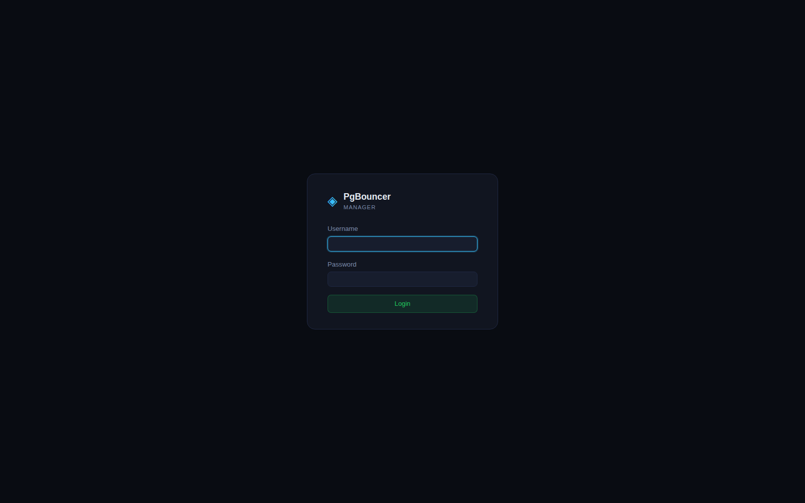 | 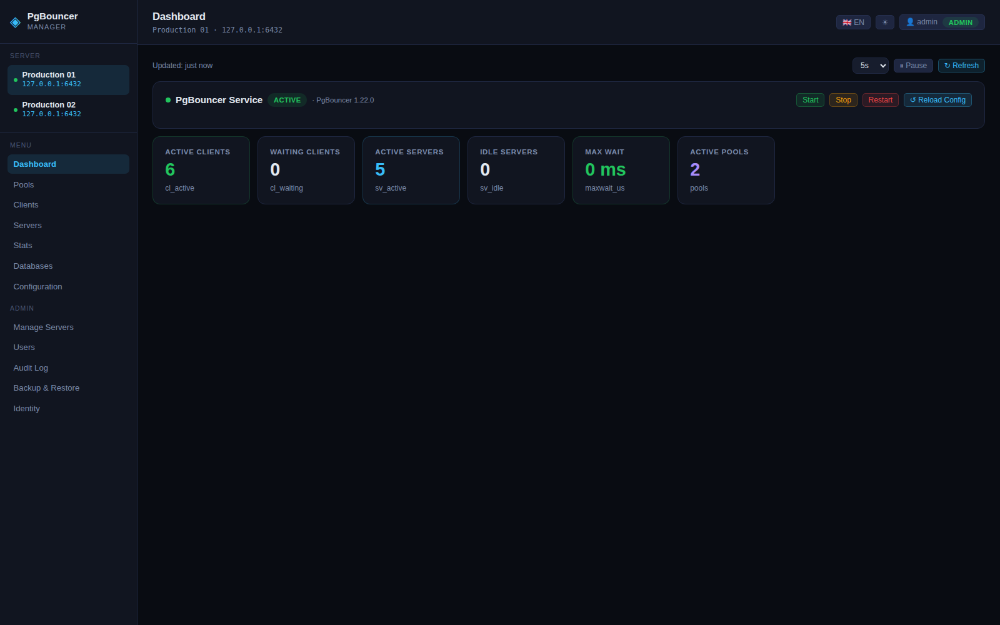 | 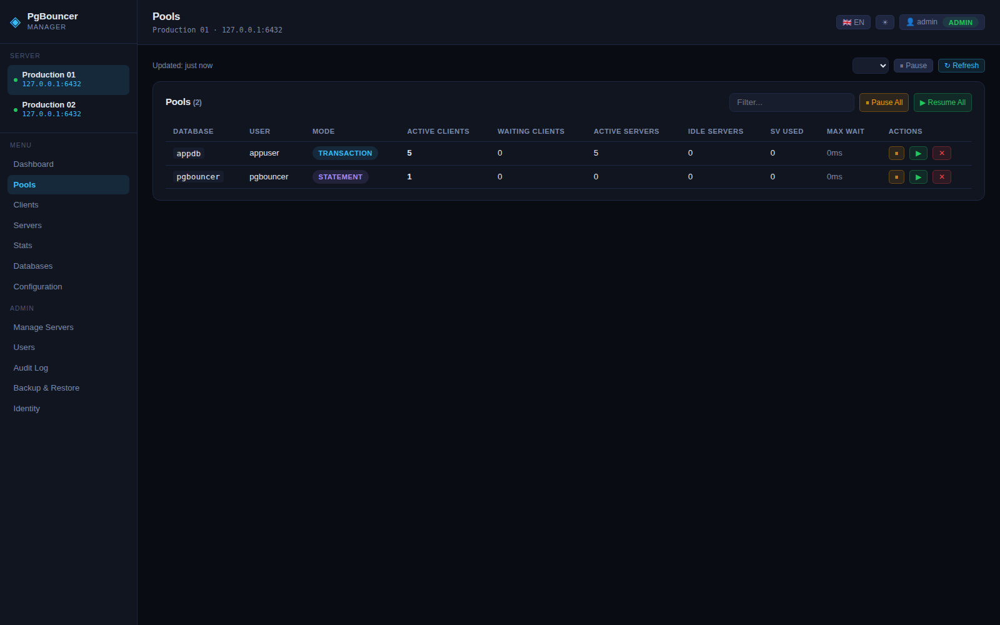 |

| Клієнти | Сервери | Статистика |
|---|---|---|
| 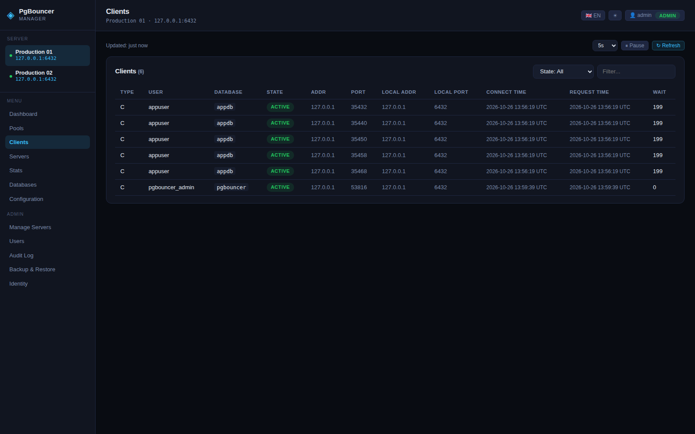 | 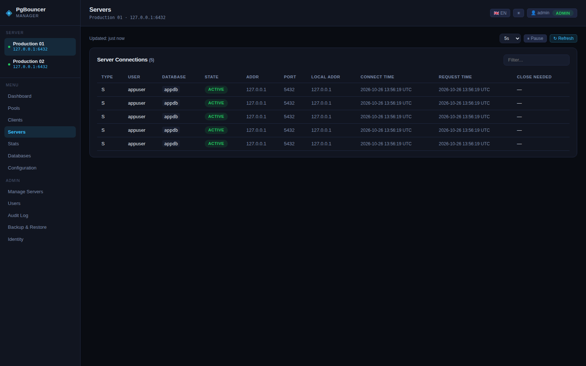 | 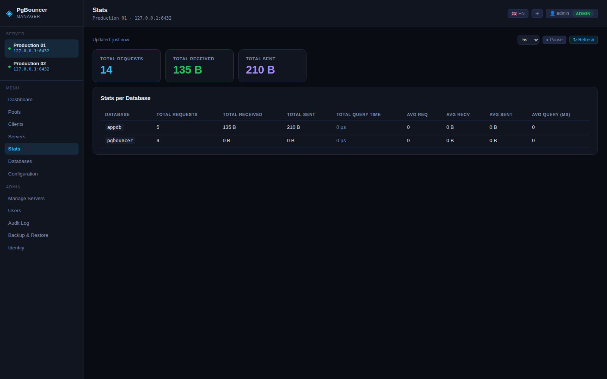 |

| Бази даних | Конфігурація | Керування Серверами |
|---|---|---|
| 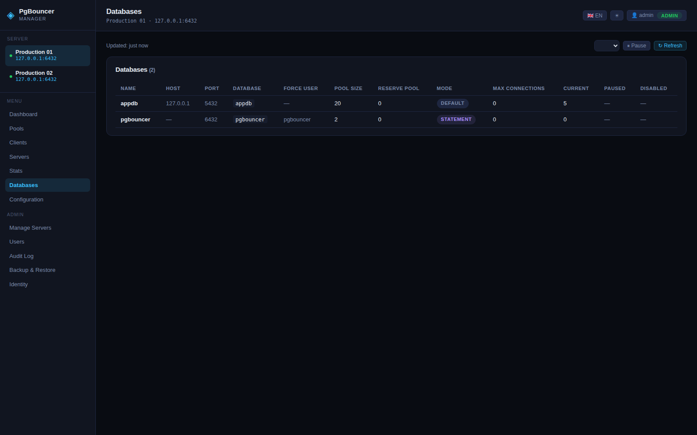 | 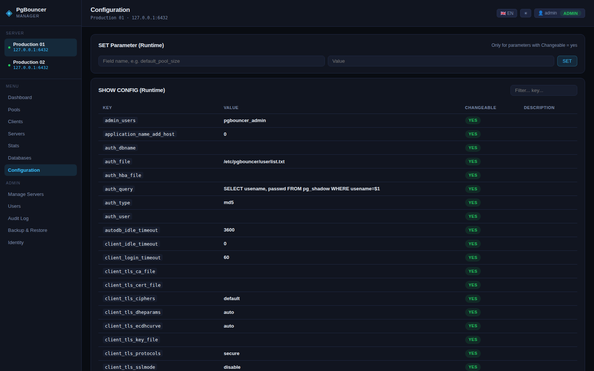 | 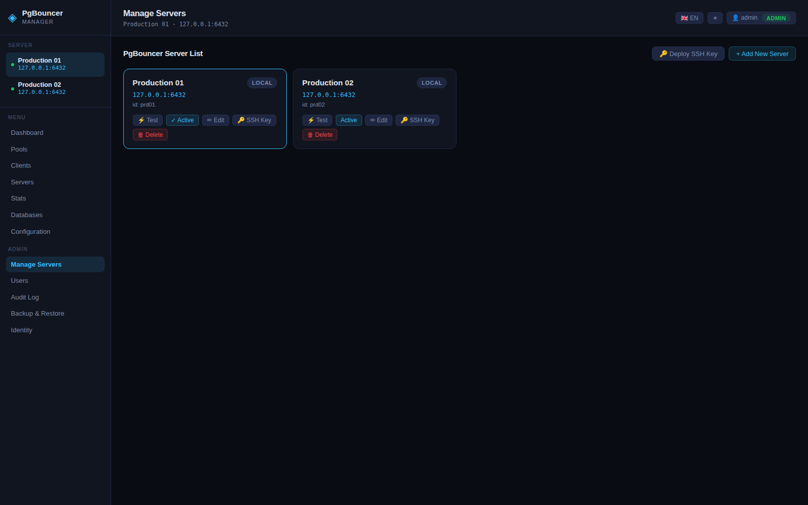 |

| Користувачі | Журнал Аудиту | Резервне Копіювання |
|---|---|---|
| 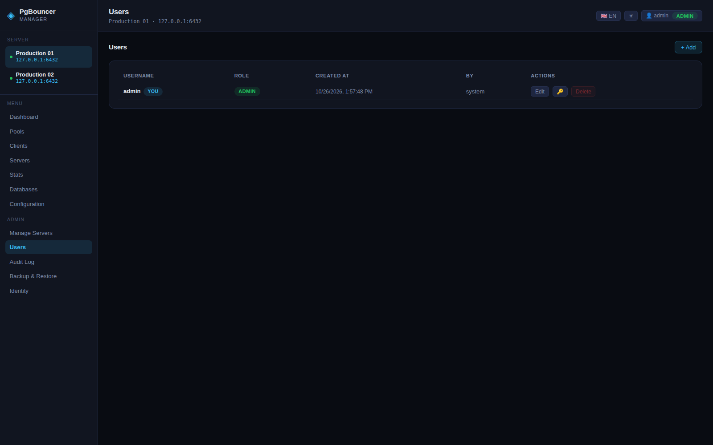 | 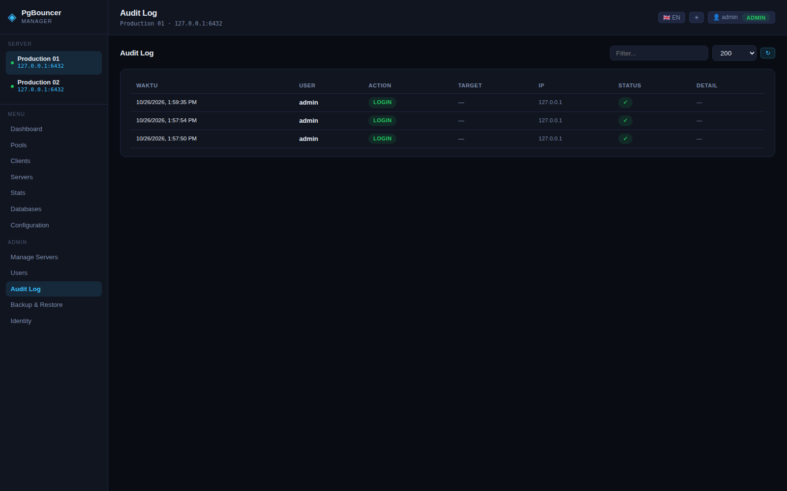 | 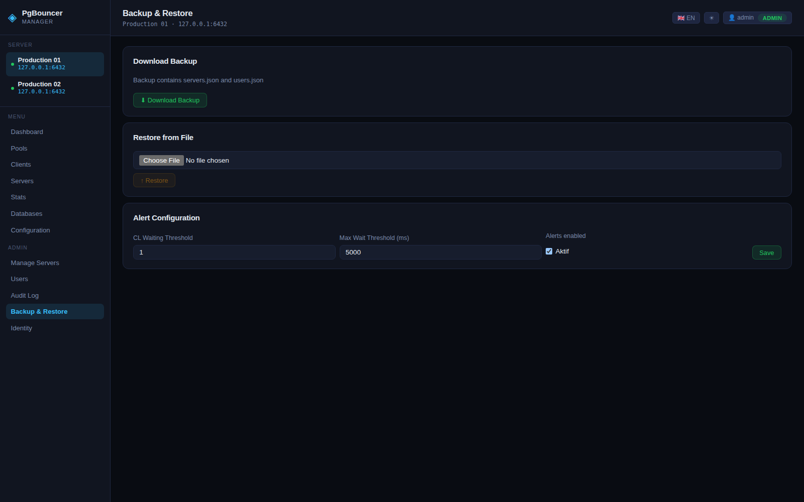 |

| Ідентичність |
|---|
| 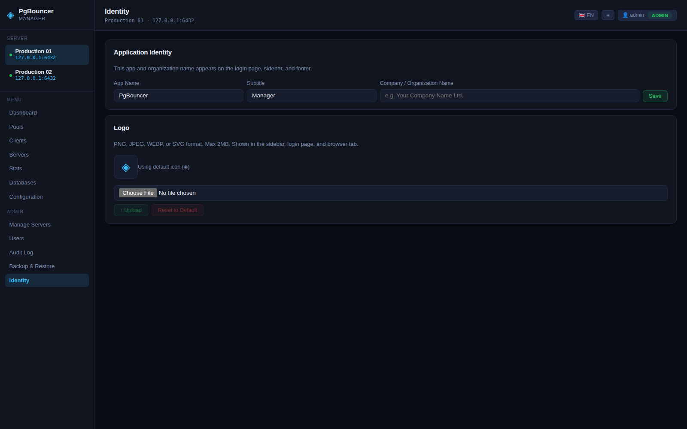 |

## Стек технологій
- Backend: Go + Gin + pgx (підключається напряму до консолі адміністрування PgBouncer через протокол Postgres)
- Frontend: Vue 3 + TypeScript + Vite (вже міститься в папці `web/`)

## Запуск frontend (розробка)

```bash
cd web
npm install
npm run dev
```

Dev-сервер Vite проксує `/api/*` на `http://localhost:8088` (див. `web/vite.config.ts`), тому
спочатку запустіть backend на Go на цьому порту.

## Збірка frontend для продакшену

```bash
cd web
npm run build
```

Результат збірки потрапляє до `web/dist/`, а backend на Go (`cmd/server/main.go`) вже
налаштований автоматично віддавати цю папку як статичні файли — тож після збірки достатньо
просто запустити бінарник Go, Node.js на продакшен-сервері не потрібен.

## Структура frontend

```
web/src/
  App.vue                    # макет дашборду + навігація вкладками
  main.ts                    # точка входу
  style.css                  # дизайн-токени (темна тема)
  types/api.ts                # типи відповідей API
  composables/api.ts          # axios-клієнт для всіх endpoint'ів backend
  composables/usePolling.ts   # автооновлення даних кожні кілька секунд (пауза при прихованій вкладці)
  components/
    ServiceStatusCard.vue     # статус + кнопки start/stop/restart/reload
    PoolsCard.vue              # SHOW POOLS + пауза/відновлення
    ReadOnlyCard.vue           # вкладки clients/servers/stats/databases (придатний для повторного використання)
    ConfigEditorCard.vue       # зміна pool_mode для кожної БД + глобальні налаштування
    DataTable.vue              # універсальна таблиця для результатів команд SHOW
```

## Попередні вимоги для PgBouncer

1. Переконайтеся, що в `pgbouncer.ini` налаштовано admin-користувача:
   ```ini
   [pgbouncer]
   admin_users = pgbouncer_admin
   ```
2. Додайте облікові дані цього admin-користувача до `userlist.txt`.
3. Переконайтеся, що admin-порт (зазвичай збігається з портом pgbouncer, за замовчуванням 6432)
   доступний з хоста, на якому запущено цей сервіс на Go.

## Налаштування sudoers (для start/stop/restart сервісу)

```bash
sudo cp deploy/sudoers-pgbouncer-manager /etc/sudoers.d/pgbouncer-manager
sudo visudo -c   # перевірка синтаксису
```

Відредагуйте `appuser` у цьому файлі, вказавши користувача, від імені якого запускається цей
бінарник Go. НЕ надавайте доступ sudo ширше, ніж ці 4 рядки команд.

## Змінні середовища

| Змінна | За замовчуванням | Опис |
|---|---|---|
| `PGB_ADMIN_HOST` | `127.0.0.1` | хост PgBouncer |
| `PGB_ADMIN_PORT` | `6432` | порт PgBouncer |
| `PGB_ADMIN_USER` | `pgbouncer_admin` | користувач, зареєстрований у `admin_users` |
| `PGB_ADMIN_PASS` | - | пароль admin-користувача |
| `PGB_INI_PATH` | `/etc/pgbouncer/pgbouncer.ini` | шлях до файлу конфігурації |
| `PGB_USERLIST_PATH` | `/etc/pgbouncer/userlist.txt` | шлях до файлу userlist |
| `PGB_SERVICE_NAME` | `pgbouncer` | ім'я systemd-юніта |
| `PGB_LISTEN_ADDR` | `:8088` | адреса, на якій слухає веб-сервер |
| `PGB_UI_USER` / `PGB_UI_PASS` | - | базова автентифікація для інтерфейсу (ОБОВ'ЯЗКОВО заповнити перед використанням поза localhost) |
| `PGB_BRANDING_FILE` | `/app/data/branding.json` | шлях зберігання назви застосунку/компанії (налаштовується через меню Branding) |
| `PGB_LOGO_FILE` | `/app/data/branding-logo` | шлях зберігання кастомного логотипу, завантаженого через меню Branding |

## Запуск

```bash
go mod tidy
export PGB_ADMIN_PASS=xxxx
export PGB_UI_USER=admin
export PGB_UI_PASS=xxxx
go run ./cmd/server
```

## Основні endpoint'и

- `GET /api/status` — статус systemd-сервісу (active/inactive/failed)
- `GET /api/pools` `/api/clients` `/api/servers` `/api/stats` `/api/databases` `/api/config` `/api/lists` `/api/version`
- `POST /api/service/{start,stop,restart}`
- `POST /api/admin/reload`
- `POST /api/admin/pause` `{"database": "optional"}`
- `POST /api/admin/resume` `{"database": "optional"}`
- `POST /api/admin/kill` `{"database": "required"}`
- `POST /api/admin/set` `{"key","value"}` — runtime SET (обмежено, див. `SHOW CONFIG`)
- `GET /api/config-edit/raw` — читає весь вміст ini-файлу у вигляді секцій
- `POST /api/config-edit/database-field` `{"database","field","value"}` — редагує ini + авто-RELOAD
- `POST /api/config-edit/global-field` `{"field","value"}` — редагує ini + авто-RELOAD
- `GET /api/branding` `/api/branding/logo` — ідентичність застосунку та логотип (публічний доступ, читається до входу)
- `PUT /api/branding` `{"company_name","app_name","app_sub"}` — лише admin
- `POST /api/branding/logo` (multipart, поле `logo`, макс. 2MB) `/ DELETE /api/branding/logo` — лише admin

## Налаштування ідентичності застосунку (Branding)

Меню **Branding** (лише для admin) дозволяє змінити назву застосунку, підзаголовок, назву
компанії/організації, що відображається у футері, та логотип (замінюючи стандартну іконку ◈) —
вони відображаються в боковій панелі, на сторінці входу та у вкладці браузера. Усі ці налаштування
зберігаються в `PGB_BRANDING_FILE`/`PGB_LOGO_FILE` і зберігаються між перезапусками контейнера,
поки папка `/app/data` змонтована як volume.

## Запуск через Docker (PgBouncer на окремому сервері)

Оскільки ваш PgBouncer працює на іншому сервері, керування start/stop/restart здійснюється через
**SSH**, а не через локальний `systemctl` всередині контейнера (контейнер не має доступу до
systemd іншого хоста). Підключення до консолі адміністрування (`SHOW POOLS` тощо) продовжують
працювати нормально, оскільки це звичайне TCP-з'єднання з портом PgBouncer — воно не залежить від
контейнера чи розташування сервера.

### 1. Підготовка сервера PgBouncer (віддаленого)

```bash
sudo useradd -m -s /bin/bash pgbouncer_ctl
sudo cp deploy/sudoers-remote-pgbouncer-host /etc/sudoers.d/pgbouncer-manager
sudo visudo -c
```

Потім згенеруйте SSH-ключ на машині, де виконуватимете `docker compose build`, і встановіть
публічний ключ на сервер PgBouncer:

```bash
ssh-keygen -t ed25519 -f ./secrets/pgb_ssh_key -N "" -C "pgbouncer-manager"
ssh-copy-id -i ./secrets/pgb_ssh_key.pub pgbouncer_ctl@<ip-сервера-pgbouncer>
```

Також переконайтеся, що admin-порт PgBouncer (за замовчуванням `6432`) доступний з мережі, в
якій працює контейнер `pgbouncer-manager`.

### 2. Конфігурація

```bash
cp .env.example .env
# відредагуйте .env: заповніть PGB_ADMIN_HOST, PGB_SSH_HOST, PGB_UI_USER/PASS тощо
```

### 3. Збірка та запуск

```bash
docker compose up -d --build
```

Застосунок буде доступний за адресою `http://<цей-хост>:8088`, з повним дашбордом (статус,
pools, clients, stats, start/stop/restart через SSH, перезавантаження конфігурації).

### Важливі зауваження

- **Вкладка "Configuration"** (зміна pool_mode) автоматично вимикається при
  `PGB_CONTROL_MODE=ssh`, оскільки цей endpoint редагує `pgbouncer.ini` на локальній файловій
  системі. У режимі SSH редагуйте `pgbouncer.ini` безпосередньо на сервері PgBouncer (вручну або
  через власний Ansible/скрипт), потім натисніть **Reload Config** на вкладці Overview — це
  продовжує працювати, оскільки `RELOAD` надсилається через консоль адміністрування PgBouncer, а
  не через файлову систему.
- Приватний ключ у `./secrets/pgb_ssh_key` монтується як Docker secret (лише для читання
  всередині контейнера, ніколи не запікається в образ). Ніколи не комітьте папку `secrets/` у git.
- Для безпеки в продакшені вкажіть `knownHostsPath` у `handlers.NewAPI` (наразі `""` = пропуск
  перевірки host key) шлях до файлу `known_hosts`, що містить відбиток сервера PgBouncer, щоб
  захиститися від атак MITM.
- Якщо колись PgBouncer переміститься на той самий хост, що й manager, просто встановіть
  `PGB_CONTROL_MODE=local` і запустіть бінарник безпосередньо на цьому хості (не в контейнері),
  щоб отримати доступ до локального systemd — див. розділ "Налаштування sudoers" вище.

- Завжди запускайте це за VPN/reverse proxy з TLS, ніколи не виставляйте напряму в інтернет.
- `PGB_UI_USER`/`PGB_UI_PASS` — це лише мінімальний рівень захисту перед застосунком. Сам вхід у
  систему вже використовує автентифікацію на основі сесій з ролями (admin і viewer, див. меню
  **Users**) — обов'язково змініть пароль облікового запису `admin` за замовчуванням одразу після
  першого розгортання.
- Перед кожним записом у `pgbouncer.ini` автоматично створюється файл `.bak`.
